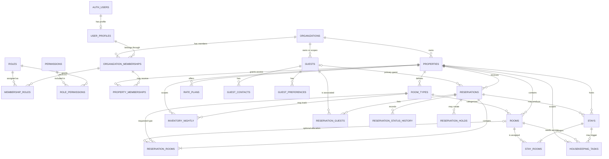
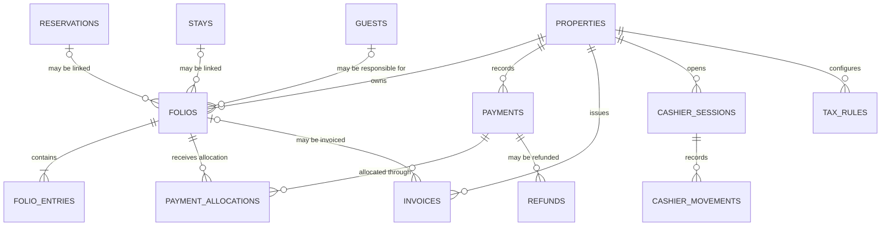
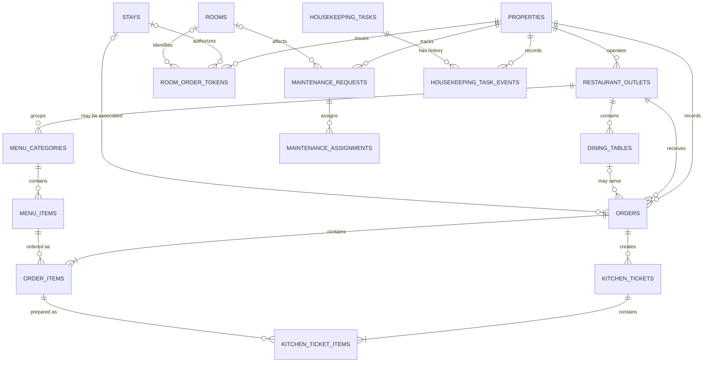
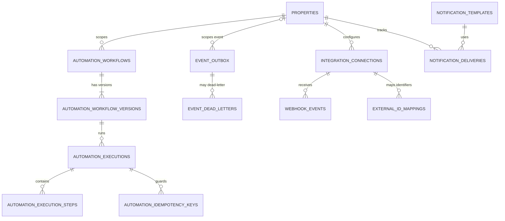

# SANDESH HOSPITALITY — Conceptual ERD

**Status:** Initial conceptual diagram — for technical review  
**Version:** 0.1.0  
**Related document:** [DATABASE-DESIGN.md](./DATABASE-DESIGN.md)

> This ERD visualizes candidate entities and relationships from the current database-design baseline. It is not an approved schema, migration, or complete accounting/inventory model. Cardinalities marked here are proposed and must be validated against detailed workflows. Fields are intentionally limited to key identifiers and scope columns.

## 1. How to read this diagram

- `PK` means primary key; `FK` means foreign key.
- `organization_id` and `property_id` are tenant/property scope keys where applicable.
- A relationship line expresses a proposed logical relationship, not necessarily a finalized foreign-key implementation.
- Composite tenant/property foreign keys are expected where needed to prevent cross-scope references.
- Authentication identities are owned by Supabase Auth; `user_profiles` references the Auth user ID.

## 2. Core identity, property, reservation, and stay model

### Important modeling notes

1. The guest scope is unresolved in the database baseline. The diagram currently shows `GUESTS` as organization-scoped; this must change if guest identity is property-scoped or shared across organizations.
2. A reservation may contain multiple reservation-room lines. Whether one reservation can produce multiple separate stays, and how group bookings work, needs explicit lifecycle rules.
3. Room-type inventory and physical-room allocation may be hybrid. Do not treat `INVENTORY_NIGHTLY` as the final inventory implementation.
4. A room allocation on a reservation line is optional in this conceptual model; assignment may instead occur during front-desk operations.
5. Property membership may be optional if organization roles grant all-property access. Confirm before schema design.

## 3. Folios and financial records

### Financial integrity notes

- `FOLIO_ENTRIES` is a ledger-like record set. Posted entries must not be silently overwritten or deleted; corrections use explicit reversals/adjustments.
- Payment allocation, folio posting, and refund state changes require transactional and idempotent operations.
- The exact accounting semantics, invoice numbering, tax treatment, and cashier reconciliation model are not yet finalized.
- This diagram does not define debit/credit accounting fields or a complete double-entry ledger.

## 4. Restaurant, kitchen, housekeeping, and maintenance

Restaurant order status, kitchen preparation status, payment status, and folio-posting status must remain separate state concepts. A room-order token must be validated server-side against its property and active stay; it is not a general guest-data credential.

## 5. Automation, events, notifications, and integrations

Automation definitions are versioned constrained JSON/DSL. Secrets must remain outside workflow JSON. Outbox publication and business changes must be committed atomically where the event represents a database business change. Delivery and execution are at-least-once, so consumers must be idempotent.

## 6. Cross-cutting scope and integrity requirements

The final physical schema must implement these rules, even where the conceptual diagram does not show every scope column:

- Tenant-owned records carry `organization_id`.
- Property-owned records carry `organization_id` and `property_id` where appropriate.
- A child record must not reference a property, reservation, guest, room, folio, or other parent from another organization/property.
- Use composite foreign keys or equivalent database constraints to enforce scope consistency.
- Apply RLS to tenant-specific tables in exposed schemas.
- Validate authorization in server-side application services as well as through RLS.
- Do not rely on UUID unpredictability or client-supplied scope IDs for access control.
- Use `timestamptz` for instants and `date` for property business dates.
- Use exact numeric types for money, never floating-point types.
- Preserve audit history and financial records; use explicit reversals rather than destructive deletion.

## 7. Deliberately not finalized in this ERD

The current source design does not settle the following, so this diagram does not invent a final answer:

1. Exact role/membership cardinalities and whether roles are global, tenant-defined, or hybrid.
2. Guest identity scope and cross-property/cross-organization deduplication.
3. Whether room-type inventory, physical-room inventory, or a hybrid is authoritative.
4. Full reservation, hold, cancellation, no-show, and group-booking lifecycle.
5. Folio accounting semantics and a complete financial ledger.
6. Tax, invoice numbering, fiscal rules, and currency precision.
7. Night-audit and property business-day records.
8. Biometric attendance vendor and attendance schema.
9. OTA/channel-manager integration entities and synchronization model.
10. Tenant billing, subscription, and usage-metering entities.
11. Final event catalog and retention policies.

## 8. Review checklist before executable schema

- [ ] Confirm organization and property membership model.
- [ ] Confirm guest profile scope.
- [ ] Confirm reservation-to-stay cardinalities and room assignment timing.
- [ ] Approve inventory and concurrency model.
- [ ] Approve folio/payment ledger model with finance requirements.
- [ ] Define night audit and business-day behavior.
- [ ] Define exact tenant/property composite foreign keys.
- [ ] Define permission matrix and RLS policies.
- [ ] Review every relationship against required workflows.
- [ ] Convert the approved model into migrations and automated database tests.

**Implementation gate:** Do not generate production migrations from this conceptual ERD until the unresolved decisions are reviewed and approved.
