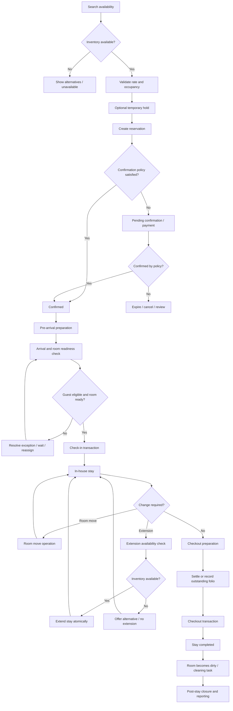

# SANDESH HOSPITALITY — Reservation Lifecycle

**Status:** Initial business-process proposal — requires product, front-desk, finance, and engineering review  
**Version:** 0.1.0  
**Scope:** V1 web-first, cloud-first platform  
**Related documents:** `docs/product/PRODUCT-REQUIREMENTS.md`, `docs/database/DATABASE-DESIGN.md`, `docs/database/ERD.md`, `docs/api/API-DESIGN.md`, `docs/security/PERMISSION-MATRIX.md`

> This document describes a proposed reservation lifecycle. It is not an implemented workflow or final operational policy. Hotel-specific rules such as check-in times, deposits, cancellation penalties, no-show handling, and invoice rules must be configured and approved before implementation.

**Controlling V1 reference:** [V1 Product and Architecture Baseline](../planning/V1-PRODUCT-AND-ARCHITECTURE-BASELINE.md). Use its release boundary and defaults where this earlier proposal is broader or still marks a decision open. External validation gates remain mandatory; this file is a design proposal, not proof of implementation.

## 1. Purpose and terminology

Define the business lifecycle from an availability search through reservation creation, confirmation, arrival, check-in, in-house stay, room changes/extensions, check-out, and post-stay closure.

Keep these concepts distinct:

- **Availability:** a time-specific view of sellable inventory; it is not a reservation.
- **Reservation:** the booking commitment and its lifecycle.
- **Reservation room line:** the room type, dates, occupancy, rate, and optional allocation requested by the booking.
- **Room assignment:** allocation of a physical room to a reservation or stay.
- **Stay:** the actual in-house lifecycle after check-in.
- **Folio:** the financial account for charges, payments, credits, and adjustments.
- **Room operational status:** housekeeping/maintenance condition; not the same as booking availability.

A reservation can exist before a stay. A stay should not be treated as proof that the reservation's financial account is settled.

## 2. Lifecycle overview

This is a conceptual flow. Actual policy branches must be configured per property and jurisdiction.

## 3. Reservation creation

### 3.1 Availability search

The client may request availability using:

- Property.
- Arrival and departure business dates.
- Occupancy (adults, children, and any configured occupancy details).
- Room type or room preferences.
- Rate plan or promotion, if applicable.
- Currency, where supported.

Server requirements:

1. Validate the property and caller's access.
2. Resolve the property's IANA timezone and business-date rules.
3. Validate that departure is after arrival and that the requested date range is permitted.
4. Calculate availability using the approved inventory model.
5. Apply occupancy, room status, out-of-order inventory, holds, and confirmed reservations correctly.
6. Return available room types/rates and relevant restrictions.
7. Avoid exposing another tenant's inventory or internal operational data.

Availability is advisory. It can become stale immediately after the response.

### 3.2 Rate and policy validation

Before creating a reservation, the server must revalidate:

- Room type and requested occupancy.
- Rate plan and applicable dates.
- Rate amount, currency, tax treatment, and included services.
- Minimum/maximum stay and arrival/departure restrictions.
- Cancellation and deposit policy.
- Guest/contact requirements.
- Property booking rules.

Never accept a trusted total, tax amount, discount, or rate from the browser. The server calculates or verifies all monetary values.

### 3.3 Temporary inventory hold

A temporary hold is optional and must be explicitly designed.

If used:

- Create the hold atomically with inventory protection.
- Give it a server-generated expiry timestamp.
- Associate it with a scoped booking attempt or reservation draft.
- Prevent the same hold from being consumed more than once.
- Release inventory safely when the hold expires or is cancelled.
- Ensure the expiry worker is idempotent.
- Recheck inventory at confirmation; a stale hold must not guarantee a booking.

The hold duration, extension policy, and whether a hold is required for each sales channel remain open decisions.

### 3.4 Reservation creation transaction

Recommended logical operation:

1. Authenticate the actor or validate the approved booking-channel credential.
2. Resolve organization/property scope.
3. Validate guest and reservation input.
4. Recalculate rates and policies on the server.
5. Check idempotency key and request fingerprint.
6. Atomically verify/consume inventory or create a valid hold.
7. Insert reservation and reservation-room lines.
8. Record the initial status-history entry.
9. Create any required folio/deposit records according to policy.
10. Write a versioned reservation-created event to the transactional outbox in the same database transaction.
11. Commit and return the canonical reservation representation.

If any required step fails, the transaction must not leave partial inventory consumption, reservation rows, or outbox events.

## 4. Reservation statuses

Candidate reservation statuses:

| Status | Meaning | Typical next states |
|---|---|---|
| Draft | Incomplete booking not yet submitted | Pending, Confirmed, Cancelled, Expired |
| Pending | Awaiting a required confirmation step | Confirmed, Cancelled, Expired |
| Confirmed | Booking accepted under property policy | Checked-in, Cancelled, No-show |
| Checked-in | Guest arrival has been processed; active stay exists | Completed, In-house exception handling |
| Cancelled | Booking cancelled under policy | Terminal; correction via audited process |
| No-show | Guest did not arrive under configured policy | Terminal or reviewed correction |
| Expired | Draft/hold/confirmation window expired | Terminal; new booking required |
| Completed | Stay/booking lifecycle closed | Terminal; post-stay financial corrections use separate ledger operations |

Do not allow arbitrary status edits. Use explicit state-transition commands that validate the current state, actor permission, property policy, and related inventory/financial effects.

The exact status model needs review: some systems model check-in/out exclusively on the stay, not the reservation. The final model should avoid duplicating inconsistent states.

## 5. Confirmation and deposit handling

Confirmation policy may depend on:

- Booking source.
- Rate plan.
- Deposit/prepayment requirement.
- Payment provider result.
- Manual review.
- Property-specific policy.

Rules:

- Payment initiation is not payment success.
- Verify provider status server-side or through a verified webhook.
- Do not confirm solely because the browser reports success.
- If a deposit is required, define whether the reservation stays Pending until the required amount is verified.
- Record confirmation actor, timestamp, policy basis, and relevant payment reference.
- If payment fails or times out, apply a documented retry/expiry process without duplicating charges or reservations.

The deposit percentage/amount, deadlines, and accepted payment methods are unresolved business decisions.

## 6. Pre-arrival preparation

Before arrival, authorized staff may:

- Review arrivals for the property business date.
- Verify guest and reservation details.
- Check special requests and operational notes.
- Confirm room assignment or identify an assignment requirement.
- Review deposit/payment status.
- Identify rooms requiring housekeeping or maintenance clearance.
- Send approved pre-arrival communication through the notification service.

Automation may create reminders or tasks, but must not silently bypass reservation, guest privacy, payment, or room-readiness rules.

## 7. Room assignment

Room assignment links a physical room to a reservation or stay according to the final domain model.

Before assignment:

1. Confirm the room belongs to the same property and organization.
2. Confirm room type compatibility and occupancy constraints.
3. Confirm no overlapping active assignment for the requested stay interval.
4. Check out-of-order/maintenance restrictions.
5. Check the property's room-readiness policy.
6. Check user permission and record the assignment actor.

Room status and booking inventory are distinct. A room marked clean does not automatically mean it is sellable, and a room with a confirmed booking is not necessarily ready for guest occupancy.

Assignment must be protected against concurrent staff actions. Database constraints/transactions are the final integrity boundary.

## 8. Check-in

### 8.1 Pre-check conditions

The check-in operation should verify:

- Reservation is in an eligible state.
- Correct property and authorized staff context.
- Guest identity/registration requirements configured for the jurisdiction.
- Required guest details and consent records are present.
- Room assignment is valid and room is ready under property policy.
- Deposit/payment requirements are satisfied or an authorized exception is recorded.
- No blocking operational or reservation conflict exists.

Do not assume every property has the same identity-document or deposit requirements.

### 8.2 Atomic check-in operation

The server should perform a controlled check-in command:

1. Lock or version-check the reservation and relevant room assignment.
2. Revalidate state, scope, and permissions.
3. Confirm the room is still valid and ready.
4. Create/activate the stay record.
5. Create or link the folio according to policy.
6. Record check-in time, business date, actor, and required registration data.
7. Update the relevant reservation/stay state consistently.
8. Write audit and outbox events in the same transaction where applicable.
9. Commit and return the canonical stay/reservation state.

Duplicate check-in requests must be idempotent or return a clear state conflict. They must not create multiple active stays.

## 9. In-house stay operations

During an active stay, authorized staff may perform defined operations:

- View stay details within their permission scope.
- Post permitted charges to the folio.
- Record verified payments.
- Create service, restaurant, or housekeeping requests.
- Record guest requests and operational notes with appropriate privacy controls.
- Move rooms through the room-move workflow.
- Extend or shorten dates through the date-change workflow.
- Handle approved incidents or exceptions through auditable operations.

Every operation must validate the active stay, property scope, actor permission, and relevant financial/operational rules.

## 10. Room move

A room move is a business transaction, not a simple room_id edit.

It must:

1. Validate the active stay and authorized actor.
2. Confirm the target room is in the same property and compatible with the stay.
3. Check target room availability for the remaining stay interval.
4. Check target room operational readiness.
5. Prevent overlapping assignments.
6. Close the previous room assignment at the correct effective time.
7. Create the new room assignment.
8. Record reason, actor, timestamp, and any rate/folio implications.
9. Update housekeeping tasks for the vacated and destination rooms.
10. Emit an auditable, idempotent event.

If the move changes pricing or taxes, use the approved rate/folio operation; do not silently overwrite posted financial records.

## 11. Stay extension or date change

An extension must recheck every additional night against current inventory.

Recommended operation:

1. Validate active stay, requested new departure date, permission, and property policy.
2. Recalculate applicable nightly rates, restrictions, taxes, and charges.
3. Check inventory for all additional nights.
4. Atomically reserve the extra inventory and update the stay/reservation dates.
5. Update relevant room assignments and folio projections/charges according to approved accounting rules.
6. Record old and new values, reason, actor, and timestamp.
7. Publish a versioned event through the outbox.

If the requested room is unavailable, do not force the extension. Offer an approved alternative room/date or require a staff decision. A room move may be needed.

Shortening a stay must define how released inventory, cancellation penalties, deposits, and already-posted charges are handled. Never silently delete or rewrite financial entries.

## 12. Cancellation

Cancellation must be a controlled command, not a generic delete.

Validate:

- Current reservation state.
- Actor permission.
- Cancellation deadline and applicable policy.
- Deposit/prepayment and refund rules.
- Related holds and inventory allocation.
- Whether any stay has already started.

Then:

- Calculate any permitted penalty on the server.
- Release eligible inventory atomically.
- Update reservation state and append status history.
- Create refund/adjustment workflow records when required; do not assume a refund is automatic.
- Write audit and outbox events.
- Return the final state and any next required action.

Cancellation after check-in should use a separate early-departure/checkout or correction workflow, not ordinary pre-arrival cancellation.

## 13. No-show

No-show processing must be property-policy-driven.

- Define the local cutoff time and property business date.
- Identify confirmed reservations that have not checked in.
- Verify that no active stay exists.
- Apply configured grace period and payment/penalty policy.
- Require staff review where the policy or guest contact process requires it.
- Record actor/system identity and reason.
- Release inventory only when policy permits.
- Process any fee or refund through the financial ledger.
- Make scheduled no-show processing idempotent and auditable.

The exact cutoff, grace period, and automatic versus manual handling are open decisions.

## 14. Checkout

### 14.1 Checkout preparation

Before checkout, authorized staff should review:

- Expected departure date and time.
- Room assignment and any room-move history.
- Outstanding folio entries and pending charges.
- Verified payments, deposits, refunds, and balance.
- Restaurant or other departmental charges awaiting posting.
- Any disputed or pending transaction.
- Guest feedback or departure notes, where appropriate.

A zero balance may be required by some property policies, but the system must support an explicitly authorized outstanding-balance exception if the product owner approves it. Do not invent a universal rule.

### 14.2 Atomic checkout operation

The checkout command should:

1. Validate active stay and actor permission.
2. Lock/version-check the stay and folio state.
3. Reconcile or identify pending departmental charges according to policy.
4. Calculate the current folio balance from ledger entries and verified allocations.
5. Enforce settlement or record an approved exception.
6. Record checkout timestamp and property business date.
7. Complete the stay and update reservation lifecycle state consistently.
8. Close the room assignment at the correct effective time.
9. Create a housekeeping task or dirty-room status transition.
10. Write audit and outbox events atomically where applicable.
11. Commit and return the completed stay and folio summary.

A checkout retry must not close the stay twice, duplicate charges, or create duplicate housekeeping tasks.

## 15. Post-checkout and post-stay closure

After checkout:

- The room enters the appropriate dirty/needs-service operational state.
- Housekeeping receives a task through a reliable event-driven process.
- The room becomes ready only after required cleaning/inspection steps.
- The reservation/stay appears in completed/departed reporting.
- Folio and invoice records remain auditable and follow fiscal retention rules.
- Post-stay messages or feedback requests may be sent only through approved notification preferences and consent rules.
- Financial corrections use separate adjustment/reversal operations.

A completed stay does not mean every payment dispute, refund, invoice correction, or reconciliation process is finished.

## 16. Exceptional cases requiring explicit workflows

Do not handle these by arbitrary status edits:

- Guest arrives early.
- Guest departs late.
- Guest does not arrive.
- Guest requests cancellation after the deadline.
- Room is unavailable or fails inspection.
- Room becomes out of order during an active stay.
- Guest needs an emergency room move.
- Reservation dates change after confirmation.
- Guest extends but inventory is unavailable.
- Multiple guests or rooms are part of one group booking.
- Duplicate reservation request is received.
- Payment provider is delayed or unavailable.
- Departmental charge arrives after checkout.
- Guest disputes a charge.
- Network outage occurs during arrival or departure.

For V1 cloud-first operation, internet outage means the web app may be unavailable. Properties need a documented manual procedure and controlled post-outage reconciliation. Do not claim offline booking/check-in support.

## 17. Events and automation triggers

Candidate domain events:

- `reservation.created`
- `reservation.pending`
- `reservation.confirmed`
- `reservation.modified`
- `reservation.cancelled`
- `reservation.no_show`
- `reservation.expired`
- `stay.checked_in`
- `stay.room_moved`
- `stay.extended`
- `stay.checked_out`
- `room.status_changed`
- `folio.entry_posted`
- `payment.verified`
- `housekeeping.task_created`
- `housekeeping.task_completed`

Each event needs a versioned schema, event ID, organization/property scope, occurrence timestamp, correlation/causation IDs where relevant, and a minimal payload. Avoid sending unnecessary guest personal data in events.

Events must be written to the transactional outbox with the corresponding business transaction. Consumers must be idempotent, tenant-scoped, retryable, and observable. Automation failure must not block the core reservation or checkout transaction.

## 18. Permissions and audit

Map each command to individual permissions from `PERMISSION-MATRIX.md`. Candidate permission groups include:

- Availability and reservation read/create/update/cancel.
- Reservation confirmation and exception handling.
- Room assignment and room move.
- Check-in and check-out.
- Guest limited/sensitive read and update.
- Folio read/post/adjust.
- Payment collect/refund/reconcile.
- No-show processing.
- Operational reports and financial reports.

Audit records should capture actor or system identity, organization/property scope, action, resource ID, timestamp, request/correlation ID, reason for sensitive changes, and safe before/after values. Do not put secrets or unnecessary personal data in audit payloads.

## 19. Required tests

### Reservation and inventory
- Concurrent requests for the last available room/night.
- Duplicate reservation creation with the same idempotency key.
- Reuse of an idempotency key with a different request body.
- Hold expiry and duplicate expiry worker execution.
- Cancellation releasing inventory exactly once.
- Modification changing multiple nights atomically.
- Physical-room overlap prevention.

### Front desk and stay
- Unauthorized check-in/check-out.
- Duplicate check-in and checkout attempts.
- Check-in with an unready or incompatible room.
- Room move with unavailable target room.
- Room move concurrent with another assignment.
- Extension when one additional night is unavailable.
- Early/late arrival/departure policy handling.
- Stay state consistency after failures.

### Finance and events
- Payment pending versus verified.
- Duplicate payment webhook.
- Refund permission and approval checks.
- Folio posting atomicity and reversal behavior.
- Checkout with outstanding balance and approved exception.
- Outbox event committed or rolled back with business transaction.
- Duplicate event delivery and consumer retries.
- Automation outage does not block booking/check-out.

### Tenant isolation
- Cross-organization reservation lookup.
- Cross-property room assignment.
- Background event with mismatched tenant/property identifiers.
- Guest data access from an unauthorized role.
- RLS and server-side permission checks.

These tests are release blockers for the corresponding workflows.

## 20. Decisions required before implementation

1. Reservation status model versus stay-only check-in/out state.
2. Whether reservations support multiple room lines and group bookings in V1.
3. Public booking channels and anonymous booking requirements.
4. Temporary inventory hold policy and duration.
5. Confirmation, deposit, and payment deadline rules.
6. Property-local check-in/check-out times and timezone handling.
7. Guest identity and registration requirements by launch jurisdiction.
8. Room assignment timing and room-readiness rules.
9. Early arrival, late departure, and no-show policy.
10. Cancellation windows, penalties, and refund policy.
11. Extension, shortening, and rate recalculation rules.
12. Folio settlement and outstanding-balance exceptions.
13. Departmental charge posting after checkout.
14. Night audit and business-day close behavior.
15. Manual outage forms and post-outage reconciliation ownership.

## 21. Implementation gate and recommended first vertical slice

Do not implement the full lifecycle in one pass. After the open decisions are reviewed, implement a narrow vertical slice:

1. Property context and room/room-type setup.
2. Availability search with tenant/property isolation.
3. Reservation creation with server-side rate validation and idempotency.
4. Atomic inventory protection and reservation status history.
5. Basic arrivals list and authorized check-in.
6. Tests for cross-tenant access, inventory races, duplicate requests, and state transitions.

Only after this slice is stable should room moves, extensions, cancellation penalties, no-show automation, folios, payments, and checkout be added in controlled increments.

**Status:** Initial proposal — not an approved or implemented reservation workflow.
